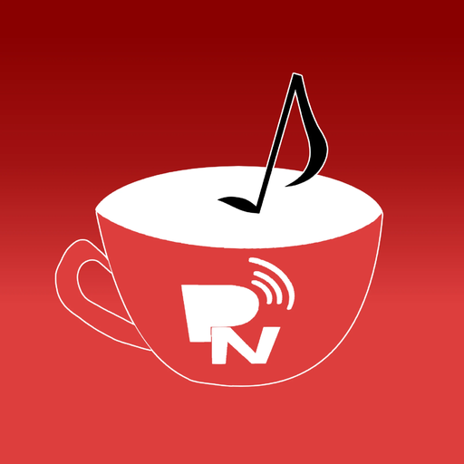

<p align="center">
  
</p>

<h1 align="center">MiiTune</h1>

<p align="center">A YouTube Music client for the Nintendo Wii U, made for the GamePad touch screen.</p>

---

MiiTune is a homebrew app that lets you search and play YouTube Music on a Wii U. I started it because I wanted
something to leave playing on the console that was nicer than a browser tab, and it grew from there.

The interface is drawn for the GamePad: big touch targets, drag to scroll, long press for a menu. It also works
with the buttons if you would rather not touch the screen. The TV mirrors the same image.

It talks to YouTube's own web API directly (no server in between), so there is nothing to host.

## What it does

- Search for songs or videos, with recent searches, quick themes and results that keep loading as you scroll
- Home page with trending tracks per region, recently played, favourites and, once signed in, your liked songs
- Artist and channel pages
- Player with synced lyrics ([LRCLIB](https://lrclib.net)), seek bar, volume, shuffle, repeat and ±10 s skips
- Play queue you can reorder, "play next", and an automatic radio when the queue runs out
- The next track is downloaded ahead of time so it starts without a pause
- Local playlists and favourites, stored on the SD card
- Sign in with your Google account (device code flow) to see your own YouTube playlists
- Last.fm scrobbling and "now playing" (needs your own Last.fm API key)
- Sleep timer, and a screen-off mode that keeps the music going
- Tries to show your console Mii in the corner (falls back to the app logo)
- English, French and Spanish, chosen on first launch and changeable in the settings

## Controls

Everything is available by touch. With the buttons:

| Button | Action |
| --- | --- |
| D-pad / left stick | Move the cursor, scroll a row |
| A | Play / confirm |
| B | Back, or jump to the side menu |
| X | Open the channel of the selected track |
| Y | Open the keyboard (search), favourite the current track (player) |
| − | Context menu (play next, add to queue/playlist, radio…), lyrics in the player |
| + | Play / pause |
| ZL / ZR | Seek −10 s / +10 s |
| L / R | Volume in lists, previous / next track in the player |

## Install

Copy the `wiiu` folder (from the release, or from `make dist`) to the root of your SD card.

- **Aroma:** `wiiu/apps/MiiTune.wuhb`
- **Homebrew Launcher:** `wiiu/apps/MiiTune/` (contains the `.rpx`, `meta.xml` and icon)

Settings, favourites, playlists and history are kept in `wiiu/apps/MiiTune/` on the SD card.

### Google sign-in (optional)

Search and playback work without it. To see your own playlists and liked songs you need your own Google API
credentials, because they are not shipped with the app:

1. In the Google Cloud console, enable the **YouTube Data API v3**.
2. Create an **OAuth client ID** of type *TVs and Limited Input devices*, and an **API key**.
3. Fill in `wiiu/apps/MiiTune/google.json`. The app creates an empty template on first launch:

```json
{
  "client_id": "…apps.googleusercontent.com",
  "client_secret": "…",
  "api_key": "…"
}
```

Sign-in tokens are stored in plain text in `miitune_account.json` next to it, so keep that card to yourself.

### Last.fm (optional)

Create an API account at <https://www.last.fm/api/account/create>, put the key and secret in
`wiiu/apps/MiiTune/lastfm.json` (also created on first launch), then open *Settings → Last.fm* and scan the QR code to
authorise. The key is also used to show artist bios.

### Diagnostics

Creating an empty `debug.txt` in `wiiu/apps/MiiTune/` shows a few extra numbers on screen (audio buffer, decoding
speed, touch source). Useful when something stutters.

## Building

You need [devkitPro](https://devkitpro.org) with `devkitPPC`, [wut](https://github.com/devkitPro/wut) and these
portlibs: SDL2, SDL2_image, SDL2_ttf, FFmpeg, curl, mbedtls and jansson.

```sh
export DEVKITPRO=/opt/devkitpro
make          # builds MiiTune.wuhb / MiiTune.rpx
make dist     # builds, then assembles the folder to copy to the SD card
```

Notes:

- The Makefile does not cope with spaces in the project path.
- Icons are [Lucide](https://lucide.dev), rasterised into a single sheet by `tools/gen_icons.py`
  (`pip install pymupdf pillow`). The app icon and splash screens come from `tools/gen_branding.py`.
- Translations live in `src/i18n_table.hpp`. Source strings are English and wrapped in `T("…")`.

## Known limits

- This uses YouTube's internal API the way the Android and web clients do. It can break whenever YouTube changes
  something, and it is not endorsed by Google or YouTube.
- Tracks are downloaded in full before they play, so the very first track of a session takes a few seconds on Wi-Fi.
- Only the GamePad is supported as a controller, no Pro Controller or Wii Remote.
- Most of the testing happened under Cemu. Behaviour on a real console may differ here and there, so bug reports
  with the console model and firmware are welcome.

## Credits

- Icons: [Lucide](https://lucide.dev), ISC license (`assets/lucide/LICENSE.txt`)
- Font: [DejaVu Sans](https://dejavu-fonts.github.io), free license (`content/LICENSE-DejaVu.txt`)
- Lyrics: [LRCLIB](https://lrclib.net)
- Built with devkitPro, wut, SDL2, FFmpeg, libcurl, mbedTLS and jansson

## License

MiiTune is free software, released under the [GNU General Public License v3.0](LICENSE).
